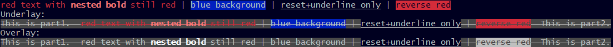

# [StyledTextDemo](https://github.com/tjgolubi/color/blob/c94e78f4048aba62f22599cebf44507c39a3c4fa/demo/StyledTextDemo.cpp)

StyledTextDemo combines pieces into one [`styled_text`](ref/color/styled_text/styled_text.md)
line, then prints it with [`underlay()`](ref/color/styled_text/underlay.md)
and [`overlay()`](ref/color/styled_text/overlay.md). Comparing the two
versions shows how local styles interact with the style of the whole line.



From the repository root, build and run it with GNU make and a C++23
toolchain that supports `<format>` and `<print>`.

```sh
make -C demo StyledTextDemo
./demo/StyledTextDemo
```

## Compose a line from styled pieces

The first group uses [`fg()`](ref/color/text_style/fg.md) to set its default
foreground to [`term_color::red`](ref/color/colors/term_color.md). The
nested [`bold()`](ref/color/styled_text/bold.md) span inherits that red and
adds bold. The plain ` | ` separators between groups have no local style.

```cpp
auto red_text = underlay(fg(red), "red text with "
              + bold("nested bold") + " still red");

auto line = red_text
          + " | " + underlay(bg(blue), "blue background")
          + " | " + absolute(underline("reset+underline only"))
          + " | " + reverse(overlay(fg(red), "reverse red"));
```

The second group supplies its own blue background with
[`bg()`](ref/color/text_style/bg.md). The third group uses
[`absolute()`](ref/color/styled_text/absolute.md) to start from terminal
defaults and [`underline()`](ref/color/styled_text/underline.md) to apply
only underline. The last group combines a red foreground with
[`reverse()`](ref/color/styled_text/reverse.md).

## Compare underlay and overlay

The demo adds plain text at both ends of the line and creates a
[`text_style`](ref/color/text_style/text_style/index.md) with white
foreground, gray background, and [`strike()`](ref/color/text_style/text_style/strike.md)
for strikethrough. It prints the same text twice, applying that style in a
different way each time.

```cpp
auto line2 = "This is part1.  " + line + "  This is part2.";
constexpr auto surrounding = fg(white).bg(gray).strike();

std::println("Underlay:");
std::println("{}", underlay(surrounding, line2));

std::println("Overlay:");
std::println("{}", overlay(surrounding, line2));
```

With **underlay**, red text keeps its red foreground and the blue-background
span keeps its blue background. The surrounding style supplies the colors
each span leaves unspecified. With **overlay**, white and gray replace the
foreground and background throughout the relative spans. In both versions,
relative spans gain strikethrough and keep their own emphasis, such as bold
or reverse. The absolute span stays underline-only in both versions.

See the [styled-text guide](styled.md#structured-styled-text) for more on
combining styles, or return to the [Demos page](demos.md).
