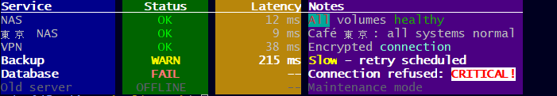

# [TableDemo](https://github.com/tjgolubi/color/blob/c94e78f4048aba62f22599cebf44507c39a3c4fa/demo/TableDemo.cpp)

This demo builds a dashboard with colored columns, emphasis across a row,
and a warning that uses its own style. Each row fits on one terminal line.
For cells that continue onto additional lines, see the
[WrapTable walkthrough](wrap-table.md).

From the repository root, build and run the demo with GNU make and a C++23
toolchain that supports `<format>` and `<print>`. Use an ANSI-capable terminal
to see the colors and emphasis.

```sh
make -C demo TableDemo
./demo/TableDemo
```

## Apply column defaults beneath cell styles

Each column supplies a [`text_style`](ref/color/text_style/text_style/index.md)
with foreground and background colors. The Notes column uses
[`fg()`](ref/color/text_style/fg.md) with
[`term_color::white`](ref/color/colors/term_color.md) and
[`bg()`](ref/color/text_style/text_style/bg.md) with
[`rgb::indigo`](ref/color/colors/rgb/rgb-constants.md). The cell helper uses
[`underlay()`](ref/color/styled_text/underlay.md) so explicit colors in a
[`styled_text`](ref/color/styled_text/styled_text.md) cell take precedence.

```cpp
using namespace tjg::color;

constexpr auto notes_color = fg(term_color::white).bg(rgb::indigo);

auto cell(styled_text text, text_style column) -> styled_text {
  return underlay(column, text);
}

auto nas_note = styled_text{"All", fg(term_color::red).bg(term_color::cyan)}
              + " volumes "
              + styled_text{"healthy", fg(term_color::green)};
```

With `cell(nas_note, notes_color)`, `All` keeps its red foreground and cyan
background. The plain ` volumes ` inherits the column's white foreground and
indigo background; `healthy` keeps its green foreground and inherits indigo.
Padding also uses the column defaults. Using
[`overlay()`](ref/color/styled_text/overlay.md) here would replace explicit
colors throughout the relative cell contents.

## Combine row emphasis with fixed-width fields

The demo's `print_row` function passes the row style to
[`tjg::color::println()`](ref/color/println.md) and formats four cells.

```cpp
tjg::color::println(row, "{:<16.16} {:^12.12} {:>12.12} {:<30.30}",
                         cell(std::move(service), service_color),
                         cell(std::move(status),  status_color),
                         cell(std::move(latency), latency_color),
                         cell(std::move(notes),   notes_color));
```

Service and Notes are left-aligned, Status is centered, and Latency is
right-aligned. Each field uses equal width and precision: short text is padded
and long text is truncated to the column width. The literal spaces between
fields use the row style rather than a column background.

The heading row combines [`bold()`](ref/color/text_style/bold.md) and
[`underline()`](ref/color/text_style/text_style/underline.md). The Backup
row uses bold, and the Old server row uses
[`faint()`](ref/color/text_style/faint.md). Relative cell contents inherit
that emphasis while retaining their explicit colors and column backgrounds.

## Protect an absolute span

The Database row uses [`absolute()`](ref/color/text_style/text_style/absolute.md)
for a red-on-white warning. Its emphasis includes
[`blink()`](ref/color/text_style/text_style/blink.md).

```cpp
using namespace tjg::color;
constexpr auto critical_style =
                          fg(rgb::red).bg(rgb::white).bold().blink().absolute();
auto db_note = styled_text{"Connection refused: "}
             + styled_text{"CRITICAL!", critical_style}
             + " Database service is unavailable";
```

`CRITICAL!` uses its own foreground, background, and emphasis. The column style
resumes after it. The Notes field's precision of 30 cuts off the trailing
explanation.



`東京` occupies six UTF-8 bytes and `Café` occupies five. Both have an estimated
display width of four columns. An ANSI-capable terminal shows the native
styling, including blink where supported.

See the [Demos page](demos.md) for the other dashboard implementations.
