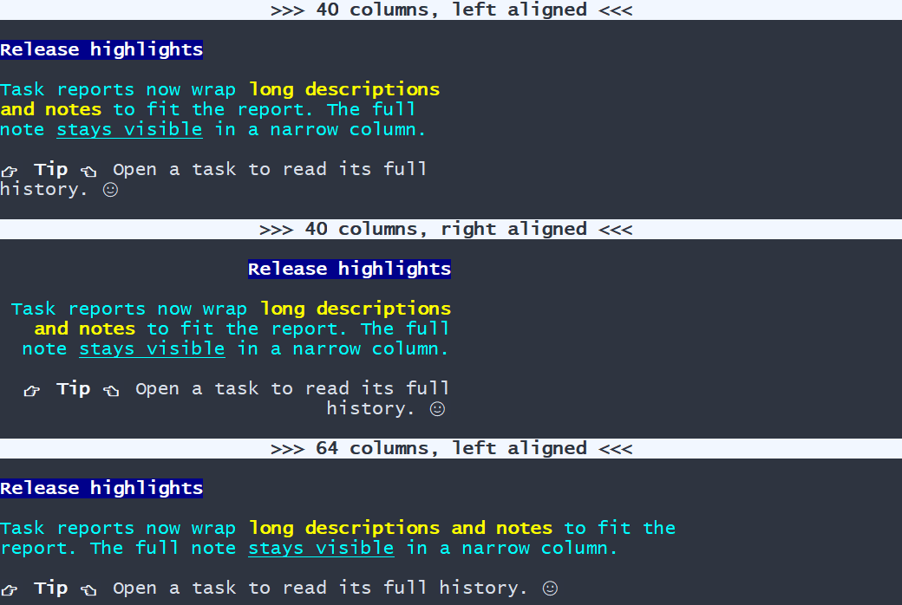

# [Wrapping tagged prose](https://github.com/tjgolubi/color/blob/dev/demo/Tagged.cpp)

The Tagged demo prints the same release note three ways. The two 40-column
examples have the same line breaks, with the lines aligned to opposite edges.
At 64 columns, the long yellow phrase fits on one line.



## Build and run

Use GNU make and a C++23 toolchain with `<format>` and `<print>`. Run the demo
in a UTF-8 terminal with color support.

```sh
make -C demo Tagged
./demo/Tagged
```

## Style the note

[`tagged()`](styled.md#styling-prose-with-tags) converts the source string to
[`styled_text`](ref/color/styled_text/styled_text.md). A dark blue background
and bold white text distinguish the title. In the body, the yellow inner tag
and bold shorthand highlight the same phrase. Cyan resumes when that tag
closes, and `_stays visible_` adds underline to a second phrase.

```cpp
auto note = tagged(
    "<bold white on dark_blue>Release highlights</>\n\n"
    "<cyan>Task reports now wrap <yellow>**long descriptions and notes**</> "
    "to fit the report. The full note _stays visible_ in a narrow column.</>");
```

## Wrap and align the same text

The demo passes the parsed note to [`wrapped()`](ref/color/wrapped.md) in
three format fields. Width sets the line limit in display columns. `<` aligns
each line to the left and `>` aligns it to the right. The colors and emphasis
stay with their text, including where the yellow phrase spans two lines.

```cpp
std::println("{:<40}", wrapped(note));
std::println("{:>40}", wrapped(note));
std::println("{:<64}", wrapped(note));
```

The demo uses fixed field widths so you can compare the results in any terminal.
For wrapped text in table cells, see [WrapTable](wrap-table.md), or return to
the [Demos page](demos.md).
