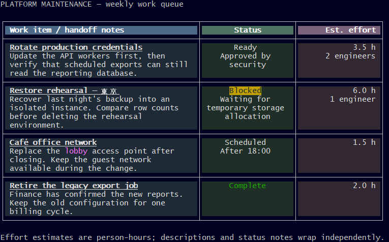

# [Wrapping text in table cells](https://github.com/tjgolubi/color/blob/dev/demo/WrapTable.cpp)

The WrapTable demo prints a work queue with left-aligned notes, centered
statuses, and right-aligned effort estimates. Each cell can span several
lines and contain text with different styles.



The demo defines the table layout in its own `table` class. It chooses the
column widths, row heights, alignment, and borders. `{color}` provides the
tools for wrapping styled text by Unicode display width and formatting the
result with the requested padding and alignment.

## Build and run the demo

From the repository root, run the following commands with GNU make and a
C++23 toolchain that supports `<format>` and `<print>`. The Makefile builds
and links the color archive as needed. Use a UTF-8 terminal that supports ANSI
colors and Unicode box-drawing characters.

```sh
make -C demo WrapTable
./demo/WrapTable
```

## Set up the columns and cells

Each column has a heading, a content width, an alignment, and a background
color. The demo uses content widths of 40, 18, and 12 display columns. Two
one-space gutters per cell and four vertical borders bring the full table
to 80 columns. The program centers the title in a field of the same width.

A row holds one [`styled_text`](ref/color/styled_text/styled_text.md) value
per column. Build each value from plain strings and styled pieces, using
`\n` wherever the cell should start a new line. In the restore row,
[`bold()`](ref/color/styled_text/bold.md) and
[`underline()`](ref/color/styled_text/underline.md) style the title.
[`fg()`](ref/color/text_style/fg.md) sets yellow on the “Blocked” label,
and [`reverse()`](ref/color/text_style/text_style/reverse.md) swaps the
foreground and background for that span. The effort estimate has two
plain lines.

```cpp
work.print_row({
  underline(bold("Restore rehearsal — 東京"))
    + "\nRecover last night's backup into an isolated instance. "
      "Compare row counts before deleting the rehearsal environment.",
  styled_text{"Blocked", fg(yellow).reverse()}
    + "\nWaiting for temporary storage allocation",
  "6.0 h\n1 engineer",
});
```

## Wrap each cell and find the row height

Pass each cell, its column width, and the indent to
[`word_wrap()`](ref/color/styled_text/word_wrap.md). It returns a vector of
styled lines ready for alignment. It keeps the styles attached to the text,
honors explicit newlines, and estimates the display width of Unicode characters.
For example, each character in `東京` occupies two display columns even
though its UTF-8 encoding uses three bytes.

```cpp
auto wrapped = std::array<std::vector<styled_text>, N>{};
auto height = std::size_t{1};
for (std::size_t i = 0; i < N; ++i) {
  auto indent = (i == 0) ? 4 : 0;
  wrapped[i] = tjg::color::word_wrap(cells[i], _columns[i].width, indent);
  height = std::max(height, wrapped[i].size());
}
```

In the first column, each work-item title starts at the left edge of the
text field. The note begins on the next line with four leading spaces, so
each note line has 36 columns for text. The status and effort columns use
their full widths on every line.

The tallest cell sets the row height. In the screenshot, the restore row's
notes take five lines, the status takes four, and the effort estimate takes
two. The demo prints all three columns on each of the five lines. When a cell
runs out of lines, the demo supplies an empty `styled_text` for that column.
Starting `height` at one also gives a wholly empty row one visible line.

## Align the lines and draw the borders

Format each wrapped line as `styled_text`. For the status column, the demo
calls [`tjg::color::print()`](ref/color/print.md). Here, `value` is the cell's
line and `style` is the [`text_style`](ref/color/text_style/text_style/index.md)
that supplies the default foreground and background colors.

```cpp
tjg::color::print(style, " {:^{}} ", value, col.width);
```

The `^` centers the line, and the inner `{}` takes the field width from
`col.width`. Use `<` for left alignment or `>` for right alignment. The
formatter measures the text in display columns and pads even an empty value
to the field width. The literal spaces outside the field form the gutters.
The enclosing style colors the cell and its padding, while explicit span
styles give labels such as “Blocked” their own appearance.

The demo prints `│` around each cell and ends each physical line with a
newline. Its `print_rule()` draws horizontal lines across the content widths
and gutters. Interior rules use the column backgrounds. The headings reuse
the same row renderer with bold text and brighter backgrounds.

## Wrap the footer

The footer is a single styled message. [`tagged()`](styled.md#styling-prose-with-tags)
underlines `person` in “person-hours”. [`wrapped()`](ref/color/wrapped.md)
prints the result at its default width of 80 columns, matching the table.

```cpp
tjg::color::println(stdout, "{}\n", wrapped(tagged(
    "Effort estimates are _person_-hours; descriptions and status notes wrap "
    "independently.")));
```

For a prose example with explicit widths and alignment, see the
[Tagged demo](tagged-demo.md).
